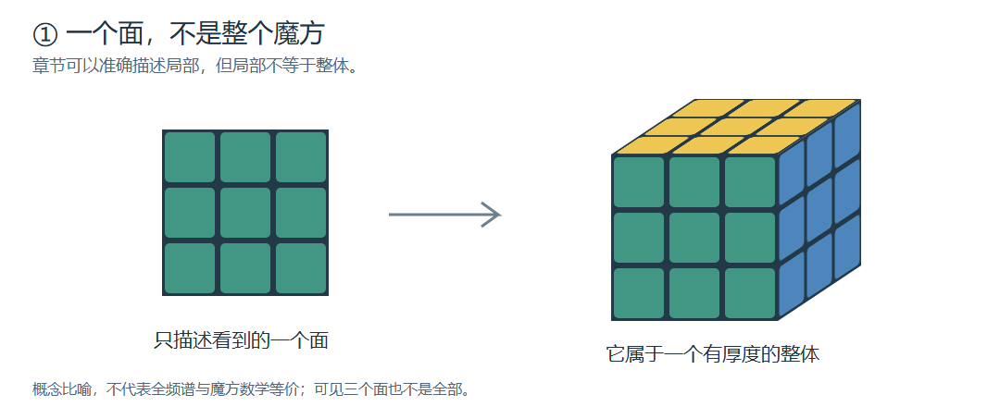
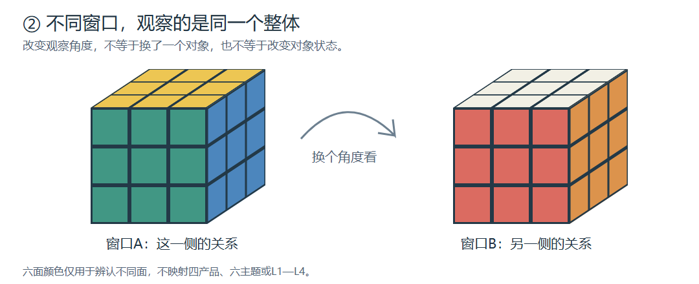
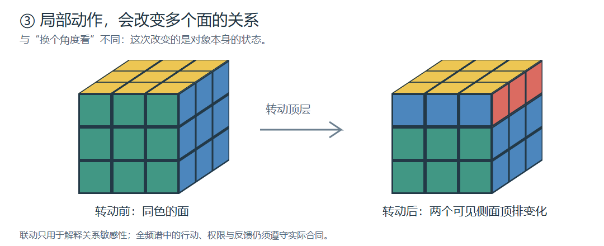

创建时间：2026-10-11 23:58（Asia/Shanghai，UTC+8）
最后更新时间：2026-10-11 23:58（Asia/Shanghai，UTC+8）
文档编号：FSP-GEX-PUB-001-ZH
文档版本：v0.1-candidate
文档状态：PUBLIC_ORIENTATION_CANDIDATE / NON_NORMATIVE
责任作者：独立全局表达工作线
范围：整体、同构递归、互联与反馈的公共导读；不批准产品合同、权限、实现或发布
事实基线：Commons main 8ae0ddb10662f8bc5cd42812e4d6d11f4c0322b3; QPP master ff5c7677f5add1842b1caa9802b2c9de37d7fea9; FSP-GLOBAL-BASELINE-1.0

# 全频谱：先看整体，再看递归

[English](./whole-system-and-recursion.md)

全频谱试图用共同原则与结构，让不同主体在保留差异、边界和责任的同时协作、形成更大整体，并在现实反馈中校准和演化。它不是中央平台吞并所有主体，也不是四个工具拼起来才有价值。

本文是一份解释和审阅用的说明，不直接制定强制规则。非规范性不等于没有价值，也不把全频谱体系本身定义成一份说明稿。整体机制在这里是设计解释；已有产品是否实现或发布，请回到其固定版本证据。

## 整体的起点与工程承接

本导读采用负责人在QPP44号确认的定位：**悲悯协议是最高原则，悲悯宪章是约束。** 工程是原则与约束的承接，不取代它们。

QPP38号A版入口另用“宪章给方向、协议给具体规则”说明双根；此处保留来源口径差异，不声称38号已统一、规范已改版或B版已激活，不增写任何条款。悲悯协议也不等于名为Protocol的软件仓库。

四个产品各自负责一部分工作：

| 产品 | 日常理解 |
|---|---|
| Protocol | 主体之间以什么身份、授权、边界和责任协作 |
| Engine | 在支持的固定输入和规则下形成可复算判断 |
| Knowledge Governance（KG） | 判断用了哪份知识、哪个版本，来自哪里、适用于什么 |
| Observer | 把获授权的现实任务与事实连接到证据、审计、回放和复核记录 |

这些是独立责任域，不等于四个必需进程或安装步骤。完整职责见[四条独立工程轨道](./four-independent-engineering-tracks.md)。

整体同时包含主体尺度纵轴、知识横轴、协议关系网络、现实与证据交叉点，以及CASE、Pack、Adapter、Skill等行业扩展。它们同时约束同一问题，而非排队经过的产品管道。

## 表达是线性的，所表达的对象不是

向一个看不见魔方的人解释魔方，可以逐面介绍，也可以演示转动，但一个面或一次转动都不是全部。

一份组件说明可以准确描述局部；还要知道它处在什么关系中。

客服、财务和组织负责人可以观察同一事件的不同方面。换视角不等于换体系，也不意味着某个视角全知。

规则变化可能影响承诺、审批与客户预期。影响是否成立仍需证据，不能把魔方的机械联动当成真实因果证明。

三图是原创概念示意，不是求解教程。颜色不映射六主题、四产品或L1—L4。“全息”描述局部与整体的关系投影，不代表局部拥有全部数据、无限权限或已证明的物理全息等价。

## 递归：每个主体既是节点，也可以是系统

同构在本导读中首先指共同生成语法：谁参与、边界在哪里、收到什么、状态怎样变化、影响沿什么关系传播、谁承担代价、依据在哪里、冲突和未知如何处理，以及怎样复核、修复、退出或演化。

不同尺度可以保留这组结构与约束，同时使用不同知识、参数、成员关系和独立历史。这不证明数学同构，也不要求所有实例相同。

L1—L4是当前关系中的治理尺度，不是永久的职位或主体类型。网络形成后可以成为更外层关系中的节点，在内部仍保留自己的结构、成员边界与历史。较大范围不产生较大人格价值或无限权限。

一次跨尺度分析可这样理解：

1. 下层留存结果与依据，提供获授权的稳定引用，包括冲突、未知和复核限制。
2. 更大主体声明自己的问题、边界与成员关系，补入本层事实、知识、资源和规则。
3. 本层重新判断关系风险，不复制下层结论，也不平均分数。
4. 结论可按权限回查依据；不可见不等于不存在，但存在性披露本身也可能受限。
5. 现实反馈形成新记录和新运行；更正与旧判断关联，不原位覆盖历史。

这是一次分析的讲述顺序，不是体系必经流程。局部循环、横向协作、上下层影响和反馈同时存在；缺少有效输入、合同或授权时，相应路径停止。详见[合成退款教学例](./examples/refund-conflict-recursion.zh-CN.md)。

## 什么留存，什么可以改变

证据平面保存事实身份、来源与稳定引用；跨层上下文由获准下层引用和本层材料组成；报告视图面向特定问题和读者。报告重点可以变，不能改写底层事实。

符石可以先理解为按具体合同形成的结构化治理记录，可关联结果与证据；不是万能记录或权限凭证。关键反证和UNKNOWN不应因摘要而消失。信息选择、遗漏和重建限制的Loss Certificate仍是研究候选，本文不冻结字段或声称统一运行时已实现。

“内核”有两个层次：体系层共享生成语法；工程设计中同一Engine Core在不同Profile和上下文下复用。已有本地计算不是纯概念，但不能由它推导完整跨尺度组合通过。

“合同”可能指关系与责任约定、授权互认条件或数据接口契约，须按具体路径区分。接口匹配不是授权，合同也不自动意味着智能合约执行。

## 三位一体：观察、推演与自我检查一起工作

用日常语言说：依据什么观察，怎样推演，怎样检查分析者自身立场与盲区，并接受反馈校准。

- 数据／场依据：区分事实、处理结果、模型指标、假设与缺失，不强制每个场景使用文明天气。
- 流程方法：v1.3为适用分析提供定位、采集、评估、传导、冲击、综合判断和介入建议。
- 元层审查：位置声明前置，审查贯穿，检查谁承受影响、有哪些替代解释，最后说明限制并邀请校准。

v5.0另有自己的五步方法；三位一体融合稿也有重组阶段。本文不将它们硬拼成唯一流程，不把方法规范变成所有API的强制格式。

观测、推演、版本化报告、现实后果、案例与反例回流、方法校准、再观测共同构成演化设计。规则修订与现实行动需各自权限和门禁，不是自动在线学习。确定性计算与生成报告分别记录；回放不保证生成文本逐字一致。

## 去哪里继续看

- [公共架构图](./public-architecture-map.zh-CN.md)：一次运行的产品职责视角，不是全部拓扑。
- [从你的问题开始](./start-from-your-question.zh-CN.md)：独立采用与业务入口。
- [七条观察路径](../research/civilization-systems-architecture/09_Full_Spectrum多尺度理解模型_七条观察路径.md)：同一体系的不同镜头。
- [全息架构事实基线](./holographic-governance-architecture-fact-baseline.md)与[证据与状态](./evidence-and-status.md)：能力声明应回到责任仓当前固定证据，不从历史状态表推断今天已通过。

来源：本稿派生自QPP44号FSP-GEX-001／003／004／006—011，固定来源提交为事实基线中的QPP提交；[固定首页原文](https://gitee.com/full-spectrum/qpp.wiki/raw/ff5c7677f5add1842b1caa9802b2c9de37d7fea9/44_全局表达_递归架构与推演输出_草稿/00_README.md)。共同生成结构另参考QPP38号全息递归核心概念基线；不复制历史规范原件。

三张图对应FSP-GEX-CUBE-001／002／003，SVG与PNG从同一QPP固定提交逐字节复制，作者为本独立全局表达工作线。本次同步采用负责人授权的原创文字与图稿，Commons许可见[LICENSE](../LICENSE)；不将这一授权扩展到未复制的第三方历史素材。

图、故事与导读不证明完整递归运行时、跨仓兼容、真实网络或生产就绪。AI代理反馈仅支持部分表达理解，不是独立盲读全部通过或真人验收。
